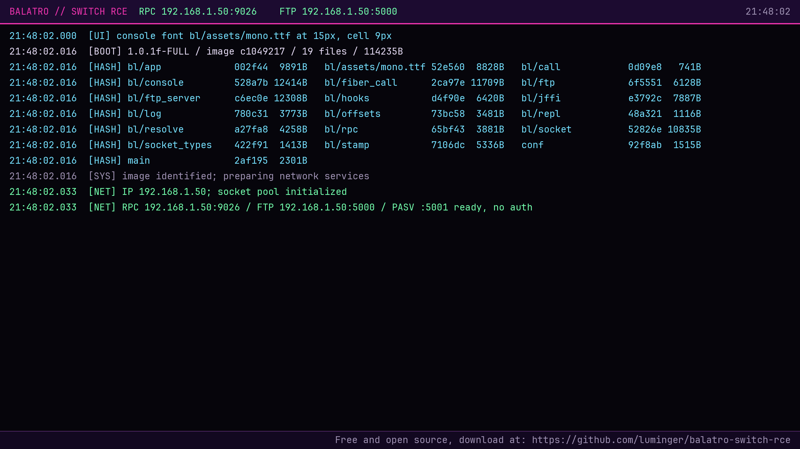

# LÖVE-on-Switch RCE (Balatro, Gravity Circuit, Arco)

Userland code execution on the Nintendo Switch 1 and 2, targeting
LÖVE-engine titles that mount their savedata ahead of romfs: a payload
delivered **entirely inside save data** that completely replaces the game
with a networked Lua REPL and an FTP server. No cartridge or romfs
modification, no title update, no CFW on the target console: the save is
installed with an ordinary save manager (or arrives through Nintendo's own
official save transfer) and the title boots straight into the launcher
instead of the game.

The original research and launcher target the **Balatro cartridge for
Switch 1** (same cartridge also runs on Switch 2 in compatibility mode,
where the same save replaces the game there as well). Two additional
launchers, contributed as ports, target **Gravity Circuit** (Switch 1
digital, `01008D9019128000` v1.0.0 and v1.2.1) and **Arco** (Switch 1
digital, `0100E6601ACB6000` v0 base and `0100E6601ACB6800` v1.2.0
update); all three ship from this repository and are built by the same
`build.py`.



## What this is

- **A proof of concept, not a product.** It demonstrates that a Switch
  title's savedata can shadow its executable's own LÖVE entry points, and
  that a save alone is enough to run attacker-authored code inside the
  game's process.
- **Userland only.** Everything runs inside the title's own process: no
  kernel, no sysmodule, no backup loading, no piracy. It does not bypass
  Nintendo's DRM and cannot run commercial games.
- **A research and instrumentation tool.** What you get on a supported
  console is an on-screen status console, a Lua REPL reachable over TCP
  (`rpc.py`, port 9026) and an FTP server for the launcher's own files
  (ports 5000/5001), enough to inspect, script and re-stage the title
  from your PC without re-flashing a save.
- **Verified on hardware**: tested with the Balatro **physical cartridge
  for Switch 1** on both a Switch 1 and a Switch 2 (after Nintendo's
  official save transfer),
  at both the patch level the cartridge ships and the latest Balatro
  patch.
- **Written for exact images**: the Switch 1 edition at the cartridge's
  stock patch level (**1.0.1f**) and at the latest patch (**1.0.1o**);
  see `src/bl/offsets.lua`.

Using this software may violate Nintendo's terms of service and can get a
console banned. Run it on hardware you own and accept the risk yourself.

## Why this works

Balatro on the Switch is a [LÖVE](https://love2d.org/) game: the retail
executable is a LÖVE runtime that loads `conf.lua` and `main.lua` from
romfs. LÖVE's `love.filesystem` mounts the **savedata ahead of romfs**, so
identically-named files in savedata shadow their romfs counterparts. A
save that carries `.lovegame/conf.lua`, `.lovegame/main.lua` and
`.lovegame/bl/*.lua` therefore replaces the game's own entry points: the
title boots straight into a standalone launcher instead of Balatro. The
save is written with an ordinary save manager (JKSV) on a hacked console,
or on Switch 2 it simply arrives with the official transfer, which moves
the save verbatim.

## What you get

- A full-screen status console painted on the very first frame (build
  id, per-file hashes, boot/network events) before any fingerprinting or
  SDK initialization.
- **RPC**: evaluate Lua in the title's process,
  `python3 rpc.py <console-ip> 'return 2+2'`.
- **FTP**: read/replace the launcher's own files (`conf.lua`, `main.lua`,
  `bl/*.lua`, `workers/*.lua`), so the launcher re-stages itself without a
  save restore.
- An append-only savedata log of every RPC/FTP peer, command and transfer
  (passwords are never logged), a phase breadcrumb that survives aborts,
  and socket rebind recovery after sleep/wake.
- **Native calls with the full AArch64 ABI**: `love.ffi.declare` turns any
  address in the title's process into an ordinary Lua function, with up to
  eight integer/pointer and eight float/double arguments and a
  void/integer/pointer/float/double return. See *Calling native code* below.

## Calling native code

The retail build's LuaJIT cannot call a cdata function pointer at all: its
`lj_vm_ffi_call` was linked with no body onto eight bytes of alignment
padding, so `ffi.cast("int(*)(int)", addr)(1)` executes an undefined
instruction and kills the process. The marshalling around it is intact and
correct — only the dispatch is missing — so the launcher rebuilds that
dispatch out of gadgets already present in the title's SDK and exposes it as
plain Lua functions:

```lua
-- in an RPC chunk: resolve from the SDK's export table, then declare
local sdk  = package.loaded["bl.app"].info.sdk_base
local pow  = love.ffi.declare("double", {"double", "double"}, sdk + 0x544470)
local blen = love.ffi.declare("size_t", {"const char *"},     sdk + 0x53b620)

return pow(2, 10)            --> 1024
```

Supported: up to 8 integer/pointer arguments (`x0`–`x7`), up to 8
float/double arguments (`d0`–`d7`), and a `void`/integer/pointer/`float`/
`double` return. Stack-passed arguments are **refused** at declare time
rather than mis-marshalled: both available return-capture gadgets pop their
saved registers from exactly where AAPCS64 puts the first stack argument, and
a census of the shipped images found no gadget without that collision.
Struct-by-value, hidden-`x8` struct returns, varargs and `long double` are
refused for the same reason — explicitly, with an error naming the cause.

Three further quirks of this LuaJIT build will bite you if you write Lua
against the title, and all four have one root cause (the VM was generated
with DynASM's FFI conditional off while the C library has `LJ_HASFFI=1`):

- `0ULL` is **not** a 64-bit literal — it evaluates to a plain number equal
  to that literal's constant-table index. Build constants with `ffi.cast`.
- 64-bit cdata `==` is **false for equal values**. Use `love.ffi.u64_eq` and
  `love.ffi.u64_is_zero`.
- Any **Lua metamethod on a cdata** kills the process. Use
  `love.ffi.metatype`, which refuses every fatal shape with a Lua error and
  allows the one that works (a table `__index`, methods included).

`docs/luajit-build-defects.md` has the instruction-level evidence for each,
including the dispatch-table artifact that proves the root cause.

`love.ffi.invoke(addr, ...)` is the same call with the older
integer-argument-only shape and a raw `x0` result. There is exactly **one**
native-call implementation behind both, with no second bridge and no
fallback: an unfamiliar image fails closed in `preflight`, which checks every
byte the chain will execute before any transfer of control. New code should
use `declare`.

> Upgrading from the initial release: `bl/fiber_call.lua` no longer exists.
> `love.ffi.invoke` is unchanged, so scripts that used it keep working; code
> that required that module directly should require `bl.ffi_call` and call
> `gp_invoke` instead.

## Supported games

| Game            | `--game`   | Title ID           | Launcher sources             | Credits                                                                                           |
| --------------- | ---------- | ------------------ | ---------------------------- | ------------------------------------------------------------------------------------------------- |
| Balatro         | `balatro`  | `0100CD801CE5E000` | `src/` (bl, workers, assets) | Luminger (original research & launcher)                                                           |
| Gravity Circuit | `gravcirc` | `01008D9019128000` | `games/gravcirc/src/gc/`     | [figurophobia/GravCirc-Switch-rce](https://github.com/figurophobia/GravCirc-Switch-rce) (port)    |
| Arco            | `arco`     | `0100E6601ACB6000` | `games/arco/src/ar/`         | [figurophobia/arco-switch-rce](https://github.com/figurophobia/arco-switch-rce) (port)            |

Every supported target is declared in [`games.py`](games.py); `build.py
--game <name>` reads that registry, so adding a new LÖVE-on-Switch title
only needs a new entry there plus its launcher sources vendored under
`games/<name>/src/`. Each game picks its own save identity, application
id, root files and tracked subdirectories; the on-console fingerprint
cross-check (`bl/stamp.lua`) is opt-in because third-party ports need
not ship it.

### Notes on Gravity Circuit

- Only `main.lua` can be shadowed: `conf.lua` is loaded by LÖVE before the
  save directory is mounted, so the launcher only replaces the game's
  `main.lua`. Everything else lives under `.Gravity Circuit/gc/`.
- The SDK module (14.3.1.0) is byte-identical between Gravity Circuit
  v1.0.0 and v1.2.1, so the same ZIP works on both. Only the main
  module's `present` and `got_memcpy` offsets differ, and `resolve.lua`
  picks the right profile at boot by code-signature matching.
- The gadget chain, FTP/RPC servers and module resolver are direct
  adaptations of Balatro's; the LuaJIT build defects described below
  apply unchanged.
- See [`games/gravcirc/README.md`](games/gravcirc/README.md) for
  per-build offset tables and the port's own notes.

### Notes on Arco

- Only `main.lua` can be shadowed, like Gravity Circuit. Launcher files
  live under `.arco/ar/`.
- Arco's shipped nnSdk (14.3.1.0) is byte-identical to Balatro 1.0.1f's,
  so every SDK gadget offset in `src/ar/ffi_call.lua` matches at the
  same address the Balatro work recorded.
- The v0 Base (`0100E6601ACB6000`) and v1.2.0 Update
  (`0100E6601ACB6800`) ship byte-identical `main` and `sdk` NSOs, so
  one offset profile (`arco-v0+v1.2.0`) covers both; `resolve.lua`
  confirms the match at boot by code-signature.
- See [`games/arco/README.md`](games/arco/README.md) for per-build
  offsets and the port's own notes.

## Building

Enter the development shell and build Balatro (default):

```sh
nix develop -c python3 build.py -o BL-new.zip
```

Or build a different launcher by name:

```sh
nix develop -c python3 build.py --game gravcirc -o GC-new.zip
nix develop -c python3 build.py --game arco     -o Arco-new.zip
```

Each build validates syntax, Lua/Python tests (Balatro only) and the
runtime file fingerprint (Balatro only; the Gravity Circuit and Arco
ports do not ship a stamp module), and writes a manifest next to the
archive. Three tests compare
the native-call gadgets against the title's own code and skip unless you
point them at your own flat NSO dumps:
`BL_FLAT_DIR=/path/to/dumps` containing `main.flat.bin` and `sdk.flat.bin`
(file offset == virtual address). No dumps are redistributed here. The archive
contains no game profiles or settings: only launcher files, the bundled
font license, and generated JKSV metadata with a **zero account UID**;
no personal data is embedded or consulted.

Status-screen renditions like the one at the top are reproducible with
`nix develop -c python3 tools/screenshot.py`.

## Installing on a hacked Switch 1

Copy the built zip to the console's `JKSV/Balatro/` folder on the SD card,
then restore it from JKSV. **The restore deletes the current Balatro
save**: the launcher is a standalone console, not a mod layered on top of
gameplay. Launch the title; the status screen comes up with the RPC/FTP
addresses once the network is ready.

## Getting the save onto a Switch 2

The Switch 2 runs the Switch 1 Balatro edition in backward-compatibility
mode, and Nintendo's own console-to-console transfer carries save data
across verbatim: the launcher files ride along inside the save. No CFW or
other modification is needed on the Switch 2 itself.

1. On the hacked **Switch 1**, restore the built launcher save with JKSV
   (this replaces the Balatro save there).
2. Transfer the save to the **Switch 2** using Nintendo's official path:
   either the full system transfer or the per-game **Save Data Transfer**
   from the Switch 2's system settings.
3. On the Switch 2, launch Balatro (the Switch 1 edition, the physical
   cartridge). The shadowed
   `conf.lua`/`main.lua` load from savedata, the fail-closed image checks
   pass in compatibility mode, and the launcher comes up. Verify the
   status row and `python3 rpc.py <console-ip> 'return 2+2'`.

A separately released **native Switch 2 Balatro** binary is a different
image and cannot inherit these Switch 1 gadget offsets; the resolver fails
closed on it.

## Live use

The status bar shows the address of each service, for example
`RPC 192.168.1.50:9026    FTP 192.168.1.50:5000`. The RPC and FTP
services are unauthenticated and unencrypted, by choice.

```sh
python3 rpc.py <console-ip> 'return 2+2'
curl --disable-epsv ftp://<console-ip>:5000/bl_log.txt
curl --disable-epsv -T local.lua ftp://<console-ip>:5000/bl/local.lua
```

Use RPC to inspect a newly uploaded Lua file immediately, or relaunch the
title to load replacements for already-required modules.

If Wi-Fi is not ready, the screen stays responsive and network setup
continues when an address arrives; a long update gap or repeated listener
errors trigger a socket rebind after sleep/wake (that path has offline
tests but still needs a real suspend/resume check). Startup failures show
`ERROR` and their reason, not a false listening claim.

A broken savedata shadow can be recovered with a known-good JKSV restore
or an external save manager; there is no in-app kill switch.

## Legal

Code: **GPL-3.0** (see `LICENSE`). The bundled JetBrains Mono subset in
`src/bl/assets/` is under the SIL Open Font License 1.1 (`OFL.txt`), which
also ships inside every built save archive.

"Balatro" and "Nintendo Switch" are trademarks of their respective owners;
this project is not affiliated with or endorsed by them. This is a proof
of concept for consoles you own. The authors take no responsibility for
what you do with it.
